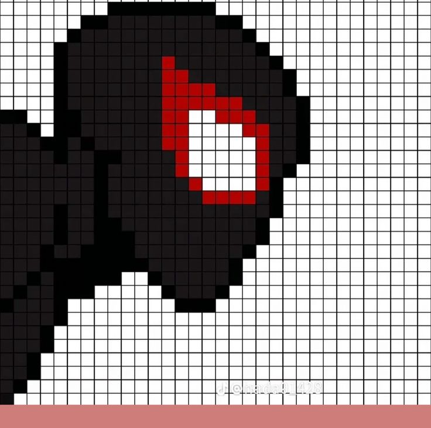

<!-- Header Banner -->

  

 

<!-- Title & Bio -->

  <h1>Hi 👋, I'm Wajhee</h1>
  <h3>AI & Backend Developer | Computer Science Student</h3>
  
<code>// Code. Create. Iterate.</code>

  
Building reliable backend systems, intelligent AI applications, and scalable solutions.

---

### 🚀 About Me

  

* 🎓 **CS Student** focused on AI, Python, and C++ development.
* 🛠️ Experienced in building **RAG applications**, REST APIs, and modern user interfaces.
* ⚡ Currently mastering **FastAPI, Docker, ChromaDB, and System Architecture**.
* 🎯 **Goal:** Build efficient, production-ready software systems that scale.

 

---

### 🤝 Connect with Me

  
  
  

---

### 💻 Tech Stack

  

